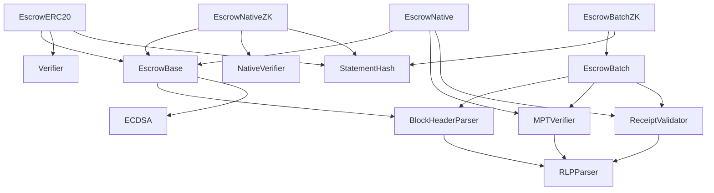

# Mirage Escrow Contracts

This repository contains the open-source Solidity escrow contracts used by Mirage for proof-based, non-custodial payment settlement.

For the full protocol model, product flow, Nomad node documentation, and Azoth documentation, see [docs.mirageprivacy.com](https://docs.mirageprivacy.com).

## High-level model

Mirage separates a private payment into offchain coordination and onchain settlement. A user deploys and funds a temporary escrow for a specific recipient, amount, asset, reward, and execution authorization.

Execution is coordinated through a reservation-style auction system. Nomad nodes inspect encrypted requests offchain and reserve a request for a short time when they are confident they can fulfill it. During that reservation window, the node sends the requested transfer from its own liquidity, then claims reimbursement by submitting an onchain proof.

The current settlement path verifies a Groth16 proof before releasing reimbursement and rewards. Nomad builds the proof offchain from Ethereum transaction or receipt data. The contract reconstructs the expected public inputs from its own state and a recent witness block. The proof binds delivery to the intent commitment while keeping the receipt, transaction index, and exact delivery block out of the collection call. Onchain deposits, recipient payments, and reimbursements remain visible.

## Contracts

### `EscrowBase.sol`

Shared base for single-transfer escrows. It handles deployer controls, cancellation, blinded-signer authorization, EIP-712 `BondAuth` validation, short-lived reservation locks, and recent block header checks.

### `EscrowNativeZK.sol`

Single native-ETH escrow. It verifies a Groth16 proof of both transaction and successful receipt inclusion at the same index. The circuit checks the transaction’s `to` and `value` against the committed payment. `EscrowNative.sol` contains the earlier plaintext path.

### `EscrowERC20.sol`

Single ERC-20 escrow. It verifies a Groth16 proof that a successful receipt contains the matching ERC-20 `Transfer(address,address,uint256)` log.

### `EscrowBatchZK.sol`

ZK batch settlement uses one native or ERC-20 Groth16 proof per row, submitted
through `collectRows`. It reuses `EscrowBatch` reservations, weighted rewards,
partial collection, cancellation, and failed-payout claims. Constructor rows
contain `(asset, amount, valueWeight, intentCommitment)` plus shared
`instanceDomain` and `requestHash`; recipients are not stored. The inherited
`expectedTransfers` recipient field is a fixed placeholder, not a settlement
recipient. The inherited plaintext `collect` always reverts.

Each statement binds its row index, commitment, principal payout, collector,
lease attempt, start/deadline blocks, and witness block. Rewards remain in the
existing separate asset-weighted accounting. Reservations expire after fifteen
minutes; proofs also have a 75-block collection deadline and 128-block witness
lookback. Clients and Nomad reject identical settlement rows; the circuit still
relies on the existing policy against overlapping identical live intents.

The verifier libraries are generated from the pinned single-row verifier
exports by `scripts/batch_verifiers.py`. `make artifacts` regenerates them and
writes `batch_zk_deployment.hex` and `batch_zk_runtime.hex`. The existing circuits
and setup keys are unchanged. Real native, nonzero-row ERC-20, and mixed-proof
collection tests live in `test/EscrowBatchZK.t.sol`.

### `EscrowBatch.sol`

Batch reservation and payout implementation reused by the ZK batch escrow. It also contains the earlier plaintext collection path. A bidder uses a constructor-approved, one-time blinded signer to reserve selected rows without collateral. Each proved row settles permanently and receives principal reimbursement plus a value-weighted reward share; expired reservations automatically release only their unfinished rows.

### Proof libraries

- `BlockHeaderParser.sol` reads block numbers and trie roots from Ethereum headers.
- `MPTVerifier.sol` verifies transaction and receipt trie inclusion.
- `ReceiptValidator.sol` validates receipt status, ERC-20 transfer logs, and native transfer fields.
- `RLPParser.sol` provides low-level RLP helpers.
- `utils/ECDSA.sol` recovers `BondAuth` / `BatchBondAuth` signers.

## Dependency graph



## Azoth pipeline and deterministic variation

This repo is the canonical source for the escrow logic. The normal build pipeline compiles these contracts with Foundry, then `make artifacts` regenerates the pinned bytecode files in `artifacts/` for:

- `EscrowERC20`
- `EscrowNativeZK` and the earlier `EscrowNative`
- `EscrowBatchZK` and the earlier `EscrowBatch`

CI includes a bytecode guard so source changes that affect compiled output must update the pinned artifacts in the same change.

Azoth sits on top of this canonical bytecode. Deployment tooling can take the open-source escrow bytecode, run it through Azoth with deterministic variation parameters, and produce a contract variant that behaves like the original escrow but has a different bytecode-level shape. That variation makes matching one known contract a less useful way to identify other Mirage escrows. Observers can still look for shared patterns in the bytecode or how the contract is used. The Groth16 proof protects payment evidence independently.

Because Azoth is deterministic, the verification path is reproducible:

1. Start from the open-source escrow source in this repository.
2. Compile it with the documented build settings.
3. Regenerate or inspect the canonical bytecode artifact.
4. Run Azoth with the same deterministic parameters used for the deployed escrow.
5. Compare the resulting bytecode with the bytecode deployed onchain.

If the bytecode matches, a user, Nomad executor, auditor, or third party can verify that the deployed contract is a valid Mirage escrow variant. This makes verification trustless: both the escrow contracts and Azoth are open source, and neither side needs to rely on a private registry or opaque build service to know what code they are interacting with.

## Development

Run tests:

```sh
nix develop -c forge test
```

Regenerate bytecode artifacts after any contract change that affects compiled output:

```sh
nix develop -c ./scripts/update_artifacts.sh
```

Use the environment pinned by `flake.lock`, as CI does. The EVM target is explicitly
set to Prague in `foundry.toml`; a different Foundry or Solidity build can still
change generated bytecode. Preserve the source revision and build settings used
for historical deployments when verifying their bytecode.
