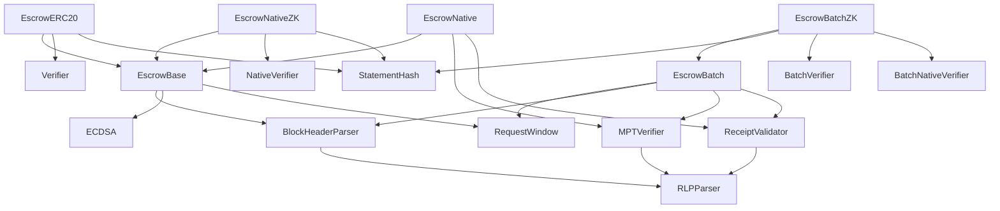

# Mirage Escrow Contracts

This repository contains the open-source Solidity escrow contracts used by Mirage for proof-based, non-custodial payment settlement.

For the full protocol model, product flow, Nomad node documentation, and Azoth documentation, see [docs.mirageprivacy.com](https://docs.mirageprivacy.com).

## High-level model

Mirage separates a private payment into offchain coordination and onchain settlement. A user deploys and funds a temporary escrow for a specific recipient, amount, asset, reward, and execution authorization.

Execution is coordinated through a reservation-style auction system. Nomad nodes inspect encrypted requests offchain and reserve a request for a short time when they are confident they can fulfill it. During that reservation window, the node sends the requested transfer from its own liquidity, then claims reimbursement by submitting an onchain proof.

The current settlement path verifies a Groth16 proof before releasing reimbursement and rewards. Nomad builds the proof offchain from Ethereum transaction or receipt data. The contract reconstructs the expected public inputs from its own state and a recent witness block. The proof binds delivery to the intent commitment while keeping the receipt, transaction index, and exact delivery block out of the collection call. Onchain deposits, recipient payments, and reimbursements remain visible.

## Contracts

### `EscrowBase.sol`

Shared base for single-transfer escrows. It handles deployer controls, cancellation, blinded-signer authorization, EIP-712 `BondAuth` validation, short-lived reservation locks, and recent block header checks.

### `EscrowNativeZK.sol`

Single native-ETH escrow. It verifies a Groth16 proof of both transaction and successful receipt inclusion at the same index. The circuit checks the transaction’s `to` and `value` against the committed payment. `EscrowNative.sol` contains the earlier plaintext path.

### `EscrowERC20.sol`

Single ERC-20 escrow. It verifies a Groth16 proof that a successful receipt contains the matching ERC-20 `Transfer(address,address,uint256)` log.

### `EscrowBatchZK.sol`

ZK batch settlement uses one native or ERC-20 Groth16 proof per row, submitted
through `collectRows`. It reuses `EscrowBatch` reservations, weighted rewards,
partial collection, cancellation, and failed-payout claims. Constructor rows
contain `(asset, amount, valueWeight, intentCommitment)` plus shared
`instanceDomain` and `requestHash`; recipients are not stored. The inherited
`expectedTransfers` recipient field is a fixed placeholder, not a settlement
recipient. The inherited plaintext `collect` always reverts.

Each statement binds its row index, commitment, principal payout, collector,
lease attempt, payment block bounds, and witness block. Rewards remain in the
existing separate asset-weighted accounting. Funding starts the fixed request
windows described below. Clients and Nomad reject identical settlement rows; the circuit still
relies on the existing policy against overlapping identical live intents.

The verifier libraries are generated from the pinned single-row verifier
exports by `scripts/batch_verifiers.py`. `make artifacts` regenerates them and
writes `batch_zk_deployment.hex` and `batch_zk_runtime.hex`. The existing circuits
and setup keys are unchanged. Real native, nonzero-row ERC-20, and mixed-proof
collection tests live in `test/EscrowBatchZK.t.sol`.

### Fixed request windows for ZK escrows

`EscrowERC20`, `EscrowNativeZK`, and `EscrowBatchZK` start one clock when funded.
An unfunded deployment has no running window. The public getters are:

| Getter | Fixed value after funding |
| --- | --- |
| `requestStartedAt()` | Funding block timestamp |
| `paymentDeadline()` | Funding timestamp + 15 minutes |
| `collectionDeadline()` | Funding timestamp + 30 minutes |
| `paymentBlockDeadline()` | Funding block + 75 |
| `collectionBlockDeadline()` | Funding block + 150 |

New bonds and bids require a timestamp strictly before `paymentDeadline` and
a block no later than `paymentBlockDeadline`. Nomad also stops new recipient
payments at those cutoffs. Existing on-time payments may be proved and collected
immediately, including after the payment window, while the timestamp is before
`collectionDeadline` and the block is no later than `collectionBlockDeadline`.
The original collector and row reservations remain protected during redemption;
payment expiry never opens those claims to a replacement bidder. Separate
collections of one bid keep its original deadlines and spend no new gas advance.

On new ZK deployments, `paymentStartBlock()` returns the deployment block. The delivery must
land strictly after that block and at or before `paymentBlockDeadline()`. The proof format
calls its lower bound `bondStartBlock`. New escrows supply the deployment height for that
field. Earlier deployed versions supply the reservation height. The single escrow's
`bondStartBlock()` getter and the batch bid's `startBlock` still report when the reservation
landed. Collection requires the current owner and a witness block strictly after that reservation.
This lets the node prove its original payment if a reorg moves it ahead of the reservation.

The circuit's `bondDeadline` remains the authenticated payment **block** cutoff.
The existing circuit does not authenticate payment timestamps, so 15 minutes is
not an exact timestamp guarantee for transaction inclusion. Its witness may
follow the payment cutoff, subject to the compiled ancestry distance and the
128-block witness lookback. A fast chain can reach the conservative collection
block bound before 30 minutes. Refunds still wait until the funding timestamp
plus 30 minutes; they cannot shorten a pending collector's redemption window.

At `collectionDeadline`, collection closes and the deployer may refund remaining
funds. Already settled rows and failed-payout claims stay final. Cancellation,
resume, retries, later reservations, and attempted re-funding cannot restart or
extend a ZK request. Reusing a completed or refunded ZK escrow requires a new
deployment. The plaintext `EscrowNative` and `EscrowBatch` retain their legacy
reservation and refund policy.

These source changes build on escrow revision
`347bfd8ea3d05ffa3e2ea5e66fcb6fd2be5c307d`. They require updated bytecode artifacts
and a new deployment; they do not change existing contracts or circuit keys.

### `EscrowBatch.sol`

Batch reservation and payout implementation reused by the ZK batch escrow. It also contains the earlier plaintext collection path. A bidder uses a constructor-approved, one-time blinded signer to reserve selected rows without collateral. Each proved row settles permanently and receives principal reimbursement plus a value-weighted reward share. For ZK batches, unfinished rows stay reserved through the collection window.

### Proof libraries

- `BlockHeaderParser.sol` reads block numbers and trie roots from Ethereum headers.
- `MPTVerifier.sol` verifies transaction and receipt trie inclusion.
- `ReceiptValidator.sol` validates receipt status, ERC-20 transfer logs, and native transfer fields.
- `RLPParser.sol` provides low-level RLP helpers.
- `utils/ECDSA.sol` recovers `BondAuth` / `BatchBondAuth` signers.

## Dependency graph



## Azoth bytecode camouflage

This repo is the canonical source for the escrow logic. The normal build pipeline compiles these contracts with Foundry, then `make artifacts` regenerates the pinned bytecode files in `artifacts/` for:

- `EscrowERC20`
- `EscrowNativeZK` and the earlier `EscrowNative`
- `EscrowBatchZK` and the earlier `EscrowBatch`

CI includes a bytecode guard so source changes that affect compiled output must update the pinned artifacts in the same change.

Azoth sits on top of this canonical bytecode. Deployment tooling can take the open-source escrow bytecode, run it through Azoth with deterministic variation parameters, and produce a contract variant that behaves like the original escrow but has a different bytecode-level shape. That variation makes matching one known contract a less useful way to identify other Mirage escrows. Observers can still look for shared patterns in the bytecode or how the contract is used. The Groth16 proof protects payment evidence independently.

Because Azoth is deterministic, the verification path is reproducible:

1. Start from the open-source escrow source in this repository.
2. Compile it with the documented build settings.
3. Regenerate or inspect the canonical bytecode artifact.
4. For fixed-window ZK escrow bytecode generated by the API, apply the API’s seed-derived window storage namespace to the deployment and runtime artifacts.
5. Run the pinned Azoth revision with the original seed and transform settings.
6. Compare the resulting deployment bytecode with the prefix of the contract creation transaction’s input. The constructor arguments follow that prefix.

If the bytecode matches, a user, Nomad executor, auditor, or third party can verify that the deployed contract is a valid Mirage escrow variant. This makes verification trustless: both the escrow contracts and Azoth are open source, and neither side needs to rely on a private registry or opaque build service to know what code they are interacting with.

## Development

Run tests:

```sh
nix develop -c forge test
```

When using Foundry 1.10 outside the pinned shell, preserve the test suite's
CREATE/EOA nonce assumptions with `forge test --no-dynamic-test-linking --no-isolate`.

Regenerate bytecode artifacts after any contract change that affects compiled output:

```sh
nix develop -c ./scripts/update_artifacts.sh
```

Use the environment pinned by `flake.lock`, as CI does. The EVM target is explicitly
set to Prague in `foundry.toml`; a different Foundry or Solidity build can still
change generated bytecode. Preserve the source revision and build settings used
for historical deployments when verifying their bytecode.

The window reserves five static slots beginning at
`0x014ac5509487808893ddf697b19b08bdb0`, beyond the legacy
layout. Short slot literals avoid constructor-only data after the embedded
runtime, a layout the pinned Azoth revision rejects. Artifact generation
checks this boundary and the EIP-170 size limit with normal compiler optimizations.
